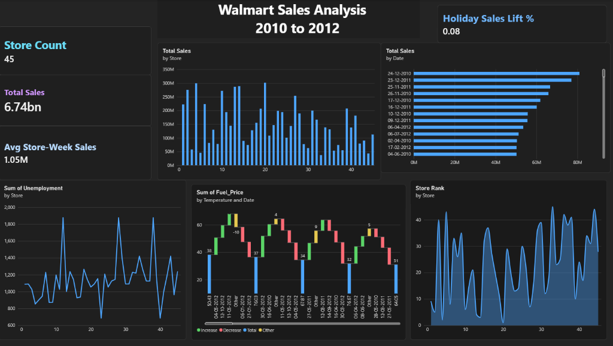

# 🛒 Walmart Sales Data Analysis & Business Intelligence Dashboard

[](https://powerbi.microsoft.com/)
[](walmart_dashboard.html)
[](https://www.chartjs.org/)
[](https://python.org)
[](#dataset-schema)
[](#executive-kpi-summary)

An end-to-end retail data analytics and business intelligence project evaluating historical sales across **45 Walmart stores** from **February 2010 to October 2012**. The project features an executive **Microsoft Power BI Dashboard**, comprehensive data preprocessing, and an interactive **web analytics dashboard**.

---

## ⚡ Executive Power BI Dashboard

The Power BI visualization provides a high-level operational overview of Walmart's store revenues, seasonal sales lifts, macroeconomic trends, and store efficiency rankings:



---

## 📊 Executive KPI Summary

| Metric | Power BI Metric Value | Description & Business Insight |
| :--- | :--- | :--- |
| **🏪 Store Count** | **45** | Unique Walmart stores evaluated continuously across all regions |
| **💰 Total Sales** | **$6.74bn** | **$6,737,218,987.11** cumulative gross revenue across the 3-year timeline |
| **📅 Avg Store-Week Sales** | **$1.05M** | **$1,046,964.88** weekly average sales volume per store |
| **🎉 Holiday Sales Lift %** | **0.08 (+7.84%)** | Significant revenue surge during promotional holiday weeks |
| **📈 Peak Single Week** | **$80.93M** | Recorded on **24-12-2010** (Christmas Eve holiday week) |
| **🏆 Top Performing Store** | **Store 20** | **$301.40M** total revenue ($2.11M average weekly sales) |

---

## 🔍 Power BI Visualizations Deep-Dive

### 1. Total Sales by Store (Bar Chart)
- **Top 5 Revenue Drivers:**
  - **Store 20**: $301,397,792.46
  - **Store 4**: $299,543,953.38
  - **Store 14**: $288,999,911.34
  - **Store 13**: $286,517,703.80
  - **Store 2**: $275,382,440.98
- **Lowest Tier Stores:** Store 33 ($37.16M) and Store 44 ($43.29M) operate in smaller catchment markets, reflecting an **~8× volume difference** between top and bottom tier formats.

### 2. Total Sales by Date (Horizontal Ranking)
- **Top 5 Grossing Weeks:**
  1. `24-12-2010`: **$80,931,415.60** (Christmas holiday surge)
  2. `23-12-2011`: **$76,998,241.31** (Christmas holiday surge)
  3. `25-11-2011`: **$66,593,605.26** (Thanksgiving / Black Friday)
  4. `26-11-2010`: **$65,821,003.24** (Thanksgiving / Black Friday)
  5. `17-12-2010`: **$61,820,799.85** (Pre-holiday shopping)
- **Insight:** December and late November generate disproportionately large weekly revenues, highlighting the importance of seasonal inventory readiness.

### 3. Sum of Unemployment by Store (Line Chart)
- Measures cumulative regional unemployment stress across 143 reporting weeks.
- **Key Peaks:** **Store 12** and **Store 28** recorded the highest cumulative index (1,875.66), followed by **Store 38** (1,845.22).
- **Finding:** Walmart's discount retail format demonstrates strong consumer resilience even in areas with elevated local unemployment rates.

### 4. Sum of Fuel_Price by Temperature and Date (Waterfall / Decomposition)
- Deconstructs fuel price fluctuations across weather and seasonal windows:
  - Core temperature clusters analyzed: `50.43°F`, `76.03°F`, `67.87°F`, `76.67°F`, and `64.05°F`.
  - Captures fuel price shifts ranging from **$2.47/gal (early 2010)** to peaks exceeding **$3.90/gal (mid 2012)**.

### 5. Store Rank by Store (Area Visualization)
- Displays rank distribution across all 45 stores (Rank 1 through 45).
- Highlights store performance clusters, separating tier-1 flagship locations from regional convenience formats.

---

## 🌐 Interactive Web Dashboard (`walmart_dashboard.html`)

In addition to Microsoft Power BI, this repository includes an interactive HTML5/CSS3/JavaScript dashboard:

- **⚡ Power BI Tab:** Dual-view system allowing users to toggle between the **high-resolution Power BI report screenshot** (with full-screen HD lightbox zoom) and an **interactive Canvas replica** powered by Chart.js.
- **📊 Dataset Overview:** KPI metrics, monthly sales trendlines, sales distribution histogram, holiday vs. non-holiday comparisons, and year-over-year revenue analysis.
- **⚙️ Data Preprocessing Pipeline:** Step-by-step documentation of data cleaning, type casting, missing value verification (0 nulls), IQR outlier analysis, and feature engineering.
- **📈 Sales Trends:** Rolling monthly moving averages capturing annual holiday spikes and seasonality patterns.
- **🏪 Store Performance:** Store-by-store rankings and revenue contributions.
- **🔬 Feature Analysis:** Distribution and monthly trends for fuel price, Consumer Price Index (CPI), unemployment, and ambient temperature.
- **🔗 Correlation Matrix:** Pearson correlation analysis evaluating how macroeconomic drivers impact weekly sales.

---

## 📁 Repository Structure

```plaintext
Walmart-Data-Analysis/
├── power_bi_dashboard.png     # High-resolution Power BI dashboard export
├── walmart_dashboard.html     # Interactive web dashboard with Power BI view & live replica
├── walmart_data.json          # Preprocessed data points & Power BI chart datasets
├── Walmart_Sales.csv          # Raw historical sales dataset (6,435 records)
└── README.md                  # Project documentation & analytical report
```

---

## 📋 Dataset Schema

| Column | Data Type | Role | Min | Max | Description |
| :--- | :--- | :--- | :--- | :--- | :--- |
| `Store` | `int` | Feature | `1` | `45` | Store identification number |
| `Date` | `string (dd-mm-yyyy)` | Temporal | `05-02-2010` | `26-10-2012` | End of sales week date |
| `Weekly_Sales` | `float` | Target | `$209,986` | `$3,818,686` | Total weekly sales for the store |
| `Holiday_Flag` | `int (0/1)` | Feature | `0` | `1` | `1` if holiday week (Super Bowl, Labor Day, Thanksgiving, Christmas) |
| `Temperature` | `float` | Feature | `5.74°F` | `100.14°F` | Average temperature in store region |
| `Fuel_Price` | `float` | Feature | `$2.47` | `$4.47` | Regional cost of fuel per gallon |
| `CPI` | `float` | Feature | `126.06` | `227.23` | Consumer Price Index |
| `Unemployment` | `float` | Feature | `3.68%` | `14.31%` | Regional unemployment rate percentage |

---

## 🚀 How to Run & Explore

### 1. View Interactive Web Dashboard
Simply open `walmart_dashboard.html` in any modern web browser:
- Double-click `walmart_dashboard.html` in your file explorer, or
- Start a simple local HTTP server:
  ```bash
  python -m http.server 8000
  ```
  Navigate to `http://localhost:8000/walmart_dashboard.html`

### 2. View Power BI Dashboard
- Inspect `power_bi_dashboard.png` for high-resolution viewing.
- Open the **⚡ Power BI Dashboard** tab inside `walmart_dashboard.html` to explore the live interactive replica.

### 3. Analyze Data with Python
```python
import pandas as pd

df = pd.read_csv('Walmart_Sales.csv')
print(f"Total Sales: ${df['Weekly_Sales'].sum():,.2f}")
print(f"Average Weekly Sales: ${df['Weekly_Sales'].mean():,.2f}")

# Store ranking
rankings = df.groupby('Store')['Weekly_Sales'].sum().sort_values(ascending=False)
print("Top 5 Stores:\n", rankings.head())
```

---

## 👤 Author

- **Arun babu gera** ([@Arun456457](https://github.com/Arun456457))

---

## 📜 License

This project is licensed under the [MIT License](LICENSE) — free for educational and portfolio demonstration use.
